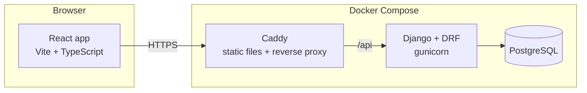

> **Historical.** This is the original full-stack build plan. The backend, Docker and AWS parts were
> later dropped; see [ADR 0007](docs/adr/0007-static-hosting.md). The full-stack version is kept on the
> `full-stack-aws` branch.

# Planet2Planet: build plan

Planet2Planet is a telecom comparison-shopping site set in the Sol system in 2380, in the Star Trek universe. A business picks two worlds, and the site compares the interplanetary subspace plans that connect them on price, latency, route and resilience.

This plan covers the product, the data and pricing model, the architecture, local development, testing, code quality, commit practice and a low-cost AWS deployment. It builds on two existing deliverables:

- `sol-telecom-2380.json`: the world, company and history data (schema in `sol-telecom-2380.d.ts`).
- `sol-telecom-2380-derivation.md`: how that data was derived, with canon references.
- `colonization-sim.js`: the agent-based simulation that produced the data, and the "Colonizing Sol" article that explains it. The site's Canon page (3.8) rebuilds that article.

It is fan work. It uses no Star Trek logos, insignia, images or interface designs, and says so on the site.

## Contents

1. [Goals](#1-goals)
2. [Setting and canon rules](#2-setting-and-canon-rules)
3. [Pages and user experience](#3-pages-and-user-experience)
4. [What plans are compared on](#4-what-plans-are-compared-on)
5. [Network and routing model](#5-network-and-routing-model)
6. [Plans and pricing model](#6-plans-and-pricing-model)
7. [Architecture](#7-architecture)
8. [Data model](#8-data-model)
9. [API](#9-api)
10. [Data pipeline](#10-data-pipeline)
11. [Frontend](#11-frontend)
12. [Local development](#12-local-development)
13. [Code quality](#13-code-quality)
14. [Testing](#14-testing)
15. [Commits](#15-commits)
16. [Milestones](#16-milestones)
17. [AWS deployment](#17-aws-deployment)
18. [Risks and open questions](#18-risks-and-open-questions)
19. [Sources](#19-sources)

---

## 1. Goals

**The site must:**

- Let a user pick any two of the 33 worlds that have a subspace constellation by 2380, and compare every plan that connects them.
- Compare plans on what matters for subspace links: price, latency, route, competition and resilience to extraordinary events.
- Show the route a plan uses on an animated map of the Sol system.
- Tell the story of Sol's communication networks on an About page grounded in canon.
- Show any reader, on a Canon page, how the worlds, networks and companies were derived from Star Trek canon, real astronomy and a Monte Carlo simulation.
- Work well on a phone first, and scale up to laptop and desktop.
- Serve as a portfolio demonstration: clean code, full tests, reproducible local setup, and a cheap, simple deployment.

**Boundaries:**

- **No real accounts, payments or checkout.** The "Request this plan" button stores a fictional inquiry.
- **One fixed date.** No live simulation; the site is a snapshot of 2380.
- **No content from after 2380 on the site.** That keeps the attack on Mars (2385), the synthetics ban, the Romulan supernova (2387) and Frontier Day (2401) out.

## 2. Setting and canon rules

- **Site date:** stardate 57436.2, the date of *Lower Decks*' first episode ("Second Contact"), in 2380.
  - **Calendar date:** under the usual 24th-century convention of 1,000 stardate units per year (41000 starts 2364), this is about 9 June 2380. The backend stores this calendar date for computing planetary positions, and the UI shows the stardate.
  - **Caveat:** stardates are not a strict calendar in canon, so this mapping is a convention, and it's documented.
- **Currency:** prices are in Federation credits, which appear in the original series.
  - **The tension:** Picard says in *First Contact* that money doesn't exist in the 24th century.
  - **How the About page resolves it:** credits are the settlement unit for commercial services traded between worlds and with partners outside the Federation.
- **Source of facts:** canon facts come only from on-screen sources, as set out in the derivation document. Anything Planet2Planet invents (pricing, company names, the conjunction rule) is labelled as invented in the code and the docs, never presented as canon in the docs.
- **On the site itself,** the About page is written in-universe, so it states the fiction plainly. The Canon page is written out-of-universe: it separates on-screen canon from what was invented, and explains the simulation. Every page's footer links to the Canon page and carries the fan disclaimer.

### Default worlds: Jupiter and Saturn

The compare page opens with **Jupiter** selected as the origin and **Saturn** as the destination.

- **It's canon's best-known regular route in the outer system.** The Jovian Run is a shuttle route between Jupiter and Saturn that both Geordi La Forge and Edward Jellico flew (TNG "Chain of Command, Part II").
- **Both ends are canon facilities.** Jupiter has Jupiter Station, home of the Holoprogramming Center where Dr. Lewis Zimmerman developed the Emergency Medical Hologram (VOY "Projections", "Life Line"; DS9 "Doctor Bashir, I Presume"). Saturn has navigational control satellites (TNG "The First Duty").
- **It shows off the routing.** The link crosses two regions (Jovian and Saturnian), each with its own mesh, and its length varies from about 4 to 15 AU over the year. Earth to Mars stays within the inner system.
- **It shows off the product range.** In the dataset, seven brands serve both ends: four backbones and three specialists (fuel logistics, station links and the emergency network). Packages add Saturn's regional carrier, Cassini Link.

An alternative default, Earth and Jupiter Station, is a one-line change in the frontend config.

## 3. Pages and user experience

### 3.1 Routes

| Path | Page |
|---|---|
| `/` | Compare (redirects to `/?from=jupiter&to=saturn` when no worlds are in the URL) |
| `/?from=moon&to=titan&sort=price&...` | Compare, with selections and filters in the URL so a comparison can be shared |
| `/about` | About Planet2Planet |
| `/canon` | Canon: how this world was built |
| `*` | Not found |

The header has three links (Compare, About, Canon), collapsing into a menu on phones.

### 3.2 Compare page

**Route picker**

- **Two native `<select>` inputs,** labelled "From" and "To".
  - **Contents:** every world with a subspace constellation by 2380, grouped by system with `<optgroup>`: Sun-orbiting worlds first, then each planet with its moons.
  - **Mutual exclusion:** the world chosen in one select is `disabled` in the other, both ways. The URL and state can never hold the same world twice, and the backend rejects it anyway.
- **No swap button.** The order of the two worlds doesn't matter for plans, so there's nothing to swap.
- **Route summary,** shown under the selects:
  - distance today
  - one-way latency today, with the year's range
  - number of providers and of competing carriers
  - when the next solar conjunction starts and ends
  - which regions the route crosses
- **A "Show route map" button** opens the map dialog (3.3).

**Filters** (a drawer directly under the world selects, closed by default; active filters show as removable chips beside its toggle):

- service class: shared, dedicated, synchronized
- maximum latency
- sector: scientific, commercial, industrial
- redundancy tier (section 4)
- provider kind
- specific providers
- conjunction rerouting required
- hardened for an environment: radiation, cryogenic, solar, gas-giant orbit

**Results**

- **Sort** by clicking any column header; the choice is kept in the URL (`sort` and `dir`). Sorting happens in the browser, so it never refetches.
- **Badges** on the best offer in each category: "Lowest price", "Lowest latency", "Most resilient".
- **One dense, spreadsheet-style comparison table at every width.** Every column sorts in the browser, the first two columns and the actions stay frozen while the rest scroll sideways inside the table, and a units line explains the abbreviations. On a phone only the checkbox and a narrow plan column stay frozen. Each offer shows:
  - plan name and lead provider (with "a division of …" where it applies)
  - monthly price and setup fee
  - latency today and its range
  - throughput and service class
  - hops and carrier handoffs
  - conjunction behaviour
  - redundancy tier
- **"Show route"** on an offer opens the map dialog with that offer's route lit.
- **"Compare"** checkboxes, up to three, open a side-by-side compare sheet.
- **Offer details** (an expandable panel) show:
  - the route segment by segment (who carries which leg)
  - the full price breakdown
  - the canon notes for both worlds
  - provider lineage (founded, parent)
- **"Request this plan"** opens a short form (company name, contact, expected traffic) that POSTs to the API. It shows a confirmation saying it's a demo and nothing is sent.

**Empty and error states:** "No plans match these filters" with a one-tap reset, and an API error with a retry button.

### 3.3 Route map dialog

- A modal dialog, full screen on mobile and a large centred panel on desktop. It traps focus, closes with Escape, and returns focus to the button that opened it.
- It uses the existing map code in `frontend/` (see 11.3).
- **Selected worlds:** full colour with labels and a soft pulse. Other worlds are dimmed, unlabelled and only shown on hover or focus.
- **Each layer the selected offer uses is drawn and animated:**
  - access links at each end, from the world to its local gateway or constellation
  - mesh links within each region, from a world to its region hub
  - backbone links between region hubs
  - any conjunction reroute
- **Each segment is coloured by layer and labelled with its carrier;** links not on the route stay faint.
- **Hovering, focusing or tapping a segment** shows its carrier, length and latency share.
- **A legend, plus a list of the route's segments as text,** so the map never depends on colour alone.
- **`prefers-reduced-motion` turns off pulsing and flow animation.**

### 3.4 About Planet2Planet page

The copy is written in-universe, as Planet2Planet's own page, and lives in the frontend as content. Sections, in order:

1. **Keeping a business connected across 30 worlds.**
   - **The problem:** an entrepreneur with a mining operation on Callisto, buyers on the Moon and a broker on Mars faces 46 brands, four kinds of carrier, regional monopolies at the edges of the system, and plan terms that hide how many companies touch their traffic.
   - **What's at stake:** a link that stalls during a solar conjunction or fails in a crisis stops the business.
2. **What Planet2Planet does.**
   - **What it does:** compares every plan between any two worlds, shows the real route and who carries each leg, prices it consistently, and flags which plans keep working when the system is under strain.
   - **Planet2Planet's own story:** an invented history, e.g. founded in 2378 in Tycho City on the Moon by two former relay-station engineers.
3. **A short history of Sol's networks,** with the visual timeline (3.5).
4. **The network today:** the animated network map with filters (3.6).
5. **How subspace works** (3.7).
6. **Built for bad days:** the redundancy tiers and the canon events behind them (section 4).
7. **Sources and fan disclaimer,** with a link to the Canon page for readers who want to know how the setting was built.

### 3.5 History timeline

- **Data:** the timeline comes from the API (`/api/history/`), which serves the 140 dated events in the database.
- **Filters:** worlds reached, constellations, companies, and the change to subspace.
- **Key milestones highlighted:**
  - 1962: Earth's first relay satellite
  - 2063: first warp flight
  - 2069 and 2103: the Moon and Mars
  - 2149: Jupiter Station's network
  - 2151: subspace arrives, and the four older networks convert to it by 2157
  - each new region reached
  - each regional carrier's spin-off
  - first million-person worlds
- **Layout:** a vertical timeline on mobile (one column, year on the left) and a horizontal scrolling timeline on desktop with era bands: pre-subspace, early subspace, expansion, mature market. Clustered years collapse into "+3 events" groups that expand on tap.
- **Visual encoding:** each event type has an icon and a colour, and every event also has a text label.

### 3.6 Network map with filters (About page)

- The same map code, showing the whole system with every link layer animated. Moving dashes run along links in the direction of traffic flow, and each layer has its own colour.
- **Filters:**
  - layer: access, mesh, backbone, cross-links
  - provider kind
  - individual providers, from a searchable multi-select
  - region
- **Selecting a provider** lights its coverage and links and dims the rest. A side panel shows its profile (kind, founded, headquarters, parent, divisions, worlds served).
- The filter state is mirrored in the URL hash (`/about#network`) so a view can be shared.

### 3.7 How subspace works (About page)

**Speed**

- **The canon figure:** about 52,000 times the speed of light (Spock, SNW "All Those Who Wander"). Data's figure in TNG "Where No One Has Gone Before" works out to about 52,090.
- **What that means in Sol:** worked examples from the dataset:
  - Earth to the Moon: about 0.025 ms
  - Earth to Mars: 5 to 24 ms
  - Earth to Jupiter: 40 to 60 ms
  - Earth to Eris: about 650 ms
  - For comparison, light-speed radio takes about 1.3 seconds to the Moon and over 9 hours to Eris.

**From amplifiers to relay networks**

- Early subspace needed amplifiers to reach distant ships (ENT "Fortunate Son", "Silent Enemy"); *Enterprise* deployed Echo One in 2151.
- By the 24th century, relay stations maintain subspace relay networks (TNG "Aquiel").
- Signals weaken over distance unless relays boost them (VOY "Message in a Bottle"), which is why routes have hops.

**Line of sight, compared with older technology**

| | Radio (pre-2151) | Optical / laser (pre-2151) | Subspace (Planet2Planet's network) |
|---|---|---|---|
| Speed | Light speed | Light speed | About 52,000 times light speed |
| Needs a clear line of sight | Yes | Yes, and precise pointing | No |
| A planet or moon in the way | Blocks it | Blocks it | No effect |
| Passing close to the Sun | Garbled by the solar corona for about two weeks around conjunction | Blinded by the Sun's glare | Degraded near the Sun; rerouted on plans that include it |
| Space weather (ion storms, flares) | Disrupts | Less affected | Disrupts; hardened relays resist |

- **Canon status:** canon doesn't state whether a planet in the way or the Sun affects subspace. The "no effect from planets, degraded near the Sun" rule is Planet2Planet's own design and is labelled as such in the docs.
- **Basis for the Sun rule:** it matches canon's pattern of space phenomena disrupting systems, and NASA's real experience of solar conjunction.
- **Radio and optical:** the comparison rows describe real-world technology; NASA uses both today.

### 3.8 Canon page

This page is for any reader who wants to know how the setting was built and how much of it is Star Trek. Unlike the About page, it is written out-of-universe. It rebuilds the "Colonizing Sol" article inside the site.

- **Where content lives:** the prose lives in `src/content/canon.ts`. Every fact, figure and sample comes from the API (sections 8 to 10).
- **Labels:** throughout the page, every claim carries one of three labels: **On screen** (canon), **Reference book** (known but not used) or **Invented** (Planet2Planet's own). Each label has a colour and also says its name in text.

Sections, in order:

1. **Built on canon, filled in by simulation.** A short introduction. The setting combines three things:
   - real astronomy for the worlds
   - on-screen Star Trek facts as fixed points
   - an agent-based simulation to fill the centuries canon leaves open

   It names the snapshot year and why 2380 was chosen.
2. **The worlds.**
   - **The filter:** how 477 known planets, dwarf planets and moons were narrowed to 33. A world needs enough gravity to be round (at least 0.06 m/s², Mimas's level) and room above its surface for satellites to orbit (inside half its Hill radius).
   - **The links:** JPL's data tables.
3. **What canon fixes.** Three tables from `/api/canon/facts/`:
   - **Starting conditions:** each fact, the episode or film that states it, and how the simulation uses it.
   - **Deadlines:** the latest date canon allows, the simulated median, and the share of runs that met it (all 100%).
   - **Set aside:** claims from reference books, or ones not found on screen, and why they were left out.

   Every fact links to its Memory Alpha article. External links open in a new tab and are marked as external.
4. **How the simulation works.**
   - **The agents:** shipyard, expedition, colony and company.
   - **The yearly steps,** as a numbered list, since they really are a sequence.
   - **How targets are chosen:** each world's value against its difficulty.
   - **The two rules that always hold:** constellation before colony, and parent before moon.
   - **"Read the simulation script":** links to `tools/colonization-sim.js` on GitHub, at the exact commit recorded with the data, so the page and the code always match.
   - **A "Run it yourself" code block,** and a link to the derivation document.
5. **Monte Carlo: many possible histories.**
   - **What is random:** whether an expedition succeeds, which world the shipyard picks, how long a colony takes to build, small differences in each colony's growth, and when companies are founded, spun off or bought.
   - **How each run works:** every run draws from a seeded random generator, so each seed is one complete, repeatable history.
   - **The spread:** 400 runs, seeds 1000 to 1399. For every world the page reports the median year and the range covering the middle 80% of runs (10th to 90th percentile).
   - **What was checked:** the canon deadlines are tested as the share of runs that met them, and the two rules are checked in every run.
   - **Separate random streams:** population and companies each draw from their own stream, so adding them changed nothing about colonization.
   - **Why the shop uses one run, not medians:** the shop needs a single consistent world, where every provider list, company history and population agrees. A "median world" isn't a history that could happen, so the site uses one run, seed 1701, and this section shows where it sits within the spread.
   - **Visual:** a strip plot for one world (Titan by default, with a world picker). It shows 400 dots, one per run, for the year the world was colonized, with the median line, the 10th-to-90th-percentile band and seed 1701 marked.
6. **Results across 400 runs.**
   - **Settlement chart:** one row per world, showing the median year of its subspace constellation and of its colony, with the 10th-to-90th-percentile band for colonization.
   - **Population chart:** median population in 2380 on a logarithmic scale, with the year each world passed a million people.
   - **Market figures:** median companies founded and brands still trading.
   - Every chart has a "Show as table" toggle.
7. **Watch one history.**
   - **Controls:** a year slider from 1962 to 2380, with play and pause, drives the existing map code (11.3).
   - **On the map:** conventional constellations are dashed and subspace ones solid, and colonies are filled.
   - **Live counts:** worlds colonized, subspace and conventional constellations, worlds over a million people, and telecom brands trading.
   - **News line:** the latest events from `/api/history/`.
   - **Motion:** nothing plays automatically. With reduced motion, the map changes without animating between years.
8. **What is invented.** The tuning numbers, the inferred founding and relay years, the single shipyard, population beyond the Moon's canon figure, the companies and their names, the pricing, and the solar conjunction rule.
9. **Sources and downloads.**
   - **Sources:** Memory Alpha articles (from the `Source` table), JPL, NASA, and Ex Astris Scientia for the stardate.
   - **Downloads:** links on GitHub to the dataset JSON, the Monte Carlo summary JSON and the derivation document.
   - **The fan disclaimer.**

### 3.9 Responsive layout

- **Built mobile first,** with single-column layouts at 360 px and up.
- **Breakpoints:**
  - `md` at 768 px: on narrower screens the actions column scrolls with the table instead of staying frozen
  - `xl` at 1280 px: the map dialog and About map get a side panel
- **Touch targets** are at least 44 px on touch devices (`pointer: coarse`) and 28 px with a mouse, so the interface can be dense. Nothing scrolls sideways except the timeline and wide tables, inside their own containers.

### 3.10 Accessibility

- **Target:** WCAG 2.2 AA.
- **Controls and keyboard:** native form controls, visible focus, a "skip to results" link, and keyboard support for every map interaction.
- **Live updates:** results announce their count through a polite live region.
- **Maps and charts:** each has a text alternative: the route's segment list on the compare page, the provider table on the About page, and a table view for every Canon page chart and for the year-by-year map.
- **Testing:** automated axe checks in Playwright (section 14).

### 3.11 Visual identity

- **An original look.** Not a copy of LCARS or any Star Trek interface, logo or insignia, so the design is its own.
- **Direction:** built for telecom engineers and procurement staff who live in spreadsheets: high information density, a white background and black text, thin grid lines, small type, and a monospace face for figures. Colour is rare and meaningful: layer colours on the maps (drawn on a dark canvas), and one colour for the three "best in category" tags.
- **Implementation:** design tokens as CSS custom properties. Light is the default whatever the system setting; a manual toggle switches to a dark theme.

## 4. What plans are compared on

These are the attributes every offer carries, all computed by Django. Reliability in ordinary conditions is assumed; the resilience tiers cover extraordinary events.

| Attribute | Meaning | Why it matters with subspace and a mesh |
|---|---|---|
| Monthly price, setup fee | In credits, with a line-by-line breakdown | Primary shopping criterion |
| Latency today | One-way, at the site date, along the actual route, including relay processing per hop | Distance changes over the year, and each hop and carrier handoff adds delay |
| Latency range | Best and worst over the planets' relative orbits | Lets a buyer plan for the worst month |
| Throughput | Committed rate, in a fictional unit such as "gigaquads per second" | Capacity tier |
| Service class | Shared (best effort), dedicated (guaranteed channel) or synchronized (timing-grade, for clearing and control) | The main quality and price lever |
| Hops and handoffs | Relay hops on the route, and how many times traffic changes carrier | Fewer handoffs means lower latency and one accountable carrier |
| On-network share | Share of the route the lead carrier owns | One carrier owning more of the route is cheaper and simpler |
| Competition on the route | Number of independent carriers able to serve the pair | Drives price; the edge of the system is a seller's market |
| Conjunction behaviour | Either "rerouted": stays up through solar conjunction via an off-axis relay, at some extra latency. Or "degraded": service level drops during conjunction | Planet2Planet's Sun rule (3.7) |
| Environment hardening | Radiation (Jovian moons), cryogenic (outer system), solar (inner system), gas-giant orbit | Required or surcharged in harsh regions |
| Resilience tier | See below | Insurance against extraordinary events |
| Sector fit | Scientific, commercial, industrial | Specialist plans fit a use case |
| Provider | Kind, founding year, parent, owner | Trust and lineage |
| Contract term | Monthly, 1 year, 3 years | Discounts for commitment |

### Resilience tiers

Each tier is a plan feature or an add-on. The About page explains each with the canon events that make it worth paying for.

| Tier | What it adds | Canon motivation |
|---|---|---|
| Standard | Single route, the carrier's normal repair commitments | — |
| Diverse path | Two routes over different backbones that share no relay hub except the two endpoints; automatic failover | A Borg cube came within reach of Earth in 2367, after Wolf 359, and was stopped in Earth orbit (TNG "The Best of Both Worlds, Part II"); the Borg attacked Earth again in 2373 (*Star Trek: First Contact*) |
| Hardened | Shielded, environment-hardened relays and power, with independent power at the endpoints | Earth's planetary power relay system went down and the Dominion was blamed (DS9 "Homefront", "Paradise Lost"); the sabotage was in fact Admiral Leyton's Red Squad. No year is given here because it was not confirmed |
| Contingency | Diverse path, plus store-and-forward buffering so no message is lost during an outage, plus a priority lane on the system-wide emergency network | The Breen attacked Earth in 2375 during the Dominion War (DS9 "The Changing Face of Evil") |
| Terraforming-zone protection | Routing that avoids relays near active terraforming operations on Mars and Venus, with compensation for disruption | Canon has terraforming under way on Mars by 2155 (ENT "Terra Prime") and stations on Venus by 2371 (DS9 "Past Tense, Part I"). The accident risk itself is invented for the product |

The Homefront and Borg references were checked for the About page (M7) against search results, because Memory Alpha blocks automated fetches. The Breen, terraforming and Venus references come from the derivation document.

## 5. Network and routing model

The network is generated once from the dataset, stored in PostgreSQL and treated as fixed data. Routing and positions are computed at request time.

### 5.1 Nodes

| Node type | One per | Position |
|---|---|---|
| Constellation | World (33) | The world's position at the site date |
| Region hub | Region (10) | The anchor world's constellation: Earth (Earth–Luna), Mars, Jupiter, Saturn, Uranus, Neptune, Pluto, Ceres (Belt), Venus (Inner), Eris (Far Kuiper) |
| Conjunction relay | A small fixed set (e.g. four) | Placed off the ecliptic so a route can bypass the Sun |

Positions:

- **Planets and dwarf planets:** heliocentric positions at the site date, from JPL's approximate Keplerian elements (planets) and its small-body database (dwarf planets), solved with Kepler's equation in 2D.
- **Moons:** placed on circular orbits around their parent, using the dataset's orbit radius and period and a fixed phase at epoch. Moon offsets matter little for latency because they are tiny next to planetary distances.

### 5.2 Links

| Layer | Connects | Owner |
|---|---|---|
| Access | A gateway or regional point of presence to a world's constellation | The gateway or regional carrier |
| Mesh | Each world to its region hub, plus neighbouring moons in the same system | The regional carrier, or the backbone that opened the region if there is no regional carrier |
| Backbone | Region hubs, along the heliocentric chain (Inner, Earth–Luna, Mars, Belt, Jovian, Saturnian, Uranian, Neptunian, Plutonian, Far Kuiper) | Each backbone owns the links between regions it serves |
| Cross-link | Skip links for a partial mesh: e.g. Earth–Luna to Jovian, Mars to Saturnian, Jovian to Neptunian | Assigned to backbones by their reach |
| Conjunction | Region hubs to conjunction relays | Backbones and plans offering rerouting |

Every link records:

- its layer and owning company
- the year it was established
- a per-hop processing delay, which defaults to 0.5 ms for mesh and 1.5 ms for backbone, plus 3 ms for each change of carrier
- a hardening flag
- a capacity class

### 5.3 Latency

- **Per segment:** propagation delay is the straight-line distance between two nodes at the site date, divided by 52,000 times light speed. Subspace needs no line of sight, so straight lines are allowed.
- **Per route:** latency is the sum of propagation, per-hop processing and handoff delays.
- **Range:** the year's best and worst values come from sampling the route at 52 dates across the year.

### 5.4 Solar conjunction rule (Planet2Planet's design choice)

- **Trigger:** a link is "degraded" when its segment passes within 0.1 AU of the Sun at the site date. That's a stand-in for the few degrees within which radio suffers today.
- **Plans with rerouting** route around degraded links through a conjunction relay and report the extra latency.
- **Plans without it** show "degraded: reduced throughput, delays possible" for the conjunction window.
- **The route summary** shows the dates of the pair's next conjunction window, found by searching forward in daily steps.

### 5.5 Routing

- **Graph:** Dijkstra's algorithm on the node and link graph, weighted by latency.
- **Which links a route may use:** only the links of the carriers allowed for that offer: the lead carrier, its divisions and its contracted partners.
- **Diverse path:** a second shortest path that avoids the first path's hubs, apart from the two endpoints, and uses a different backbone.
- **Implementation:** plain Python with `heapq`, no graph library needed for about 50 nodes. Routes are pure functions of their inputs, so they're memoised per (origin, destination, carriers, date).

## 6. Plans and pricing model

### 6.1 Plan catalogue (stored)

- **Generation:** a management command creates each company's plans from templates for its kind, using a fixed seed. The plans are stored in the database and are not changed by requests.
- **Price positioning:** each company gets a stored factor between 0.85 and 1.25 that sets how cheap or premium it is. Older backbones are more premium; startups price lower.

| Company kind | Plan templates | Notes |
|---|---|---|
| Backbone | Transit Shared, Transit Dedicated, Synchronized Trunk, Diverse Path, Contingency | Can sell end to end anywhere it reaches |
| Regional carrier | Regional Shared, Regional Dedicated | End to end within its region; access leg in packages |
| Local gateway | Access Basic, Access Pro | Access leg only, never standalone |
| Specialist | One or two niche plans, e.g. Mining Telemetry Ops (low rate, telemetry-grade, hardened), Clearing Sync (synchronized), Research Bulk (high rate, shared), Station Link, Emergency Priority (add-on) | Sold end to end within its coverage, or as an add-on |

Each plan stores:

- service class and throughput
- base monthly price and setup fee
- resilience tier
- conjunction rerouting (yes or no)
- environment hardening
- sectors
- contract terms and their discounts
- whether it can be sold standalone or as part of a package

### 6.2 Offers (computed per request)

For an origin and a destination, the pricing service assembles three kinds of offer:

1. **End-to-end offers:** a plan from a company whose coverage includes both worlds.
2. **Packages:** an access plan at the origin, plus a backbone transit plan, plus an access plan at the destination. The lead provider is the transit carrier.
   - **Partners:** gateways and regional carriers at each end.
   - **Preference:** packages within one corporate family (spin-offs and divisions) are preferred and discounted.
   - **Size limit:** at most three packages per transit carrier, to keep the result count reasonable.
3. **Add-ons:** the emergency-priority and hardening add-ons, applied to eligible offers as options shown on the offer, not as separate offers.

Duplicate offers are merged. Each offer gets a deterministic ID (a hash of its plans and route) so it can be shared in a URL.

### 6.3 Price formula

All parameters live in a `PricingParameter` table and can be changed in Django admin.

```
segment cost   = base(plan) × throughput factor × class factor
transit cost   = Σ over backbone hops (per-hop rate × hop length factor)
handoff fees   = handoff fee × number of carrier changes
subtotal       = access(origin) + transit + access(destination) + handoffs
market factor  = competition factor(independent carriers on the pair) × market-size factor(smaller population of the two ends)
environment    = 1 + Σ surcharges for hardening required at either end
resilience     = tier multiplier (+ conjunction rerouting fee)
monthly price  = subtotal × provider positioning × market factor × environment × resilience × term discount
```

- **Competition factor:** falls as more independent carriers serve the pair. At about 1.35 for a single carrier, down to a floor of about 0.85 with five or more. That's what makes the edge of the system expensive.
- **Market-size factor:** worlds with fewer people cost more per unit.
- **Package discount:** within one corporate family, handoff fees are waived and a 5% discount applies.
- **Rounding:** prices round to whole credits.
- **Breakdown:** the response includes every line, so the UI can show it and tests can check that the lines add up.

## 7. Architecture



**Repository layout**

```
/
├── PLAN.md
├── README.md
├── docker-compose.yml           # local development
├── docker-compose.prod.yml      # single-host production (section 17)
├── Makefile                     # make up, make test, make lint, make seed …
├── .env.example
├── .pre-commit-config.yaml
├── .github/workflows/ci.yml
├── docs/
│   ├── sol-telecom-2380-derivation.md
│   └── adr/                     # short architecture decision records
├── tools/
│   └── colonization-sim.js      # regenerates the dataset; not run by the app
├── backend/
│   ├── pyproject.toml           # dependencies, ruff, pytest config
│   ├── manage.py
│   ├── config/                  # settings (base, dev, test, prod), urls, wsgi
│   ├── data/
│   │   ├── sol-telecom-2380.json        # one run (seed 1701): the shop's world
│   │   ├── sol-montecarlo-2380.json     # summary of 400 runs, for the Canon page
│   │   └── canon-facts.json             # curated canon facts, from the derivation document
│   └── apps/
│       ├── catalog/             # worlds, regions, companies, sources, events
│       ├── canon/               # canon facts, simulation runs and statistics
│       ├── network/             # nodes, links, ephemeris, routing
│       ├── pricing/             # plans, parameters, offer assembly, price formula
│       └── inquiries/           # "Request this plan" submissions
├── frontend/                    # existing folder, including the map code
│   ├── package.json
│   ├── src/
│   │   ├── app/                 # router, providers, layout
│   │   ├── pages/               # ComparePage, AboutPage, CanonPage, NotFound
│   │   ├── features/            # route-picker, results, filters, map-dialog, timeline, network-map,
│   │   │                        # canon-facts, monte-carlo, history-player
│   │   ├── components/          # shared UI, including small SVG chart components
│   │   ├── content/             # About and Canon copy, UI labels
│   │   ├── map/                 # existing map code + adapter
│   │   └── api/                 # generated types and query hooks
│   └── tests/                   # Vitest unit tests
└── e2e/                         # Playwright tests
```

## 8. Data model

All models live in PostgreSQL through the Django ORM. Primary keys are the dataset's kebab-case slugs where one exists, so IDs are stable across reloads.

**catalog**

| Model | Key fields |
|---|---|
| `Source` | slug, title, url |
| `Region` | slug, name, order |
| `World` | slug, name, type, parent (self), region, gaseous, radius_km, mass_kg, surface_gravity, main_elements (array), distance_from_sun_au, orbit_radius_km, orbital_period_days, orbital_speed_km_s, constellation_established, constellation_started_as, subspace_since, colonized, homeworld, passed_one_million, population |
| `PopulationSnapshot` | world, year, population |
| `CanonNote` | world, year, text, source |
| `Company` | slug, name, kind, sectors (array), environment, focus, headquarters (World), region, founded, parent (self), origin, status, owner (self), acquired_by (self), acquired_year, price_positioning |
| `ServiceArea` | company, world (unique together): who sells where in 2380 |
| `Event` | year, type, world, company, buyer, detail |

**network**

| Model | Key fields |
|---|---|
| `OrbitalElements` | world (Sun-orbiting worlds only), semi_major_axis_au, eccentricity, longitude_of_perihelion_deg, mean_longitude_deg at J2000, mean_motion_deg_per_day, source |
| `MoonPhase` | world, phase_deg at epoch |
| `Node` | slug, kind (constellation, region hub, conjunction relay), world, region, fixed_position (for relays) |
| `Link` | slug, layer, a (Node), b (Node), operator (Company), established, processing_ms, hardened, capacity_class |

**pricing**

| Model | Key fields |
|---|---|
| `PlanTemplate` | kind, code, name, service_class, base defaults |
| `Plan` | slug, company, template, name, service_class, throughput, monthly_base, setup_fee, resilience_tier, conjunction_reroute, environments (array), sectors (array), standalone, terms (JSON: term to discount) |
| `PricingParameter` | key, value, description |

**canon**

| Model | Key fields |
|---|---|
| `CanonFact` | slug, category (starting condition, deadline, set aside), topic, world (optional), statement, episodes (array), how_used, standing (on screen, reference book, not found), source (`Source`), deadline_event (colonized, constellation, population; deadlines only), deadline_year, deadline_threshold, order |
| `SimulationRun` | slug, kind (canonical or Monte Carlo), first_seed, run_count, start_year, end_year, script_commit (the git commit of `tools/colonization-sim.js` that produced it), generated_at |
| `WorldStatistic` | run, world, metric (constellation year, subspace year, colonized year, one-million year, population), median, p10, p90, share_of_runs (how many runs reached it), samples (integer array, one value per run, for the strip plot) |
| `DeadlineResult` | run, canon_fact, share_met |
| `MarketStatistic` | run, metric (companies founded, brands trading, companies bought, brands by kind), median, p10, p90 |

**inquiries**

| Model | Key fields |
|---|---|
| `Inquiry` | offer_id, origin, destination, company_name, contact, expected_traffic, created_at |

**Constraints:**

- a check constraint that a world is never its own parent
- unique (company, world) on `ServiceArea`
- a check constraint that a link's two ends differ
- database indexes on the slugs used as filters

## 9. API

Django REST Framework, with an OpenAPI schema from drf-spectacular. The frontend's TypeScript types are generated from that schema with `openapi-typescript`, so the contract can't drift. Every endpoint except the inquiry POST is read-only and cacheable.

| Method and path | Purpose |
|---|---|
| `GET /api/meta/` | Site date, stardate, subspace speed, sources |
| `GET /api/worlds/` | Worlds for the selects: id, name, type, parent, region, eligibility |
| `GET /api/worlds/{id}/` | Full world detail including canon notes |
| `GET /api/regions/` | Regions and their worlds |
| `GET /api/companies/?kind=&sector=&world=&status=` | Providers, with lineage |
| `GET /api/network/?layer=&company=&region=` | Nodes, links (with a degraded flag at the site date) and orbit data for the maps; nodes carry no positions except the fixed conjunction relays |
| `GET /api/history/?type=` | Timeline events |
| `GET /api/canon/facts/?category=` | Canon facts with episodes, sources and, for deadlines, the simulated result |
| `GET /api/simulation/` | Run metadata (seeds, run count, script commit), market statistics and deadline results |
| `GET /api/simulation/worlds/?metric=&world=&samples=` | Per-world medians and percentiles; per-run samples only when `samples=true` and one world is named |
| `GET /api/quotes/?from=&to=&sort=&class=&sector=&tier=&kind=&company=&maxLatencyMs=&reroute=&env=` | Route summary and priced offers |
| `POST /api/inquiries/` | Store a "Request this plan" submission |
| `GET /api/health/` | Health check for Docker and the host |

**Quote response (abridged)**

```json
{
  "route": {
    "from": "jupiter", "to": "saturn",
    "date": "2380-06-09", "stardate": "57436.2",
    "distanceKm": 1.2e9,
    "latencyMs": { "direct": 76.9 },
    "regions": ["jovian", "saturnian"],
    "independentCarriers": 4,
    "conjunction": { "activeNow": false, "nextStart": "2381-..", "nextEnd": "2381-.." }
  },
  "offers": [
    {
      "id": "of_3f9a…",
      "title": "Synchronized Trunk",
      "leadCompanyId": "jovian-subspace",
      "ownerId": null,
      "serviceClass": "synchronized",
      "throughput": 40,
      "resilienceTier": "diverse-path",
      "conjunction": "rerouted",
      "environments": ["radiation"],
      "sectors": ["commercial", "industrial"],
      "hops": 4, "handoffs": 0, "onNetworkShare": 1.0,
      "latencyMs": { "now": 81.2, "min": 47.3, "max": 171.4 },
      "price": {
        "monthly": 4180, "setup": 900, "currency": "credits",
        "breakdown": [{ "label": "Transit, 1 backbone hop", "credits": 2600 }]
      },
      "segments": [
        { "companyId": "jovian-subspace", "layer": "mesh", "nodeIds": ["c-jupiter", "h-jovian"], "linkIds": ["…"] }
      ],
      "badges": ["lowest-latency"]
    }
  ]
}
```

**Validation** (DRF serializers, with errors returned as HTTP 400 and field messages):

- `from` and `to` are required, must be known world IDs, and must differ.
- Both worlds must have a subspace constellation by the site date.
- Filter values must come from known enumerations; `maxLatencyMs` must be a positive number with a sensible upper bound.
- Unknown query parameters are rejected, which catches typos in the frontend.
- Inquiry POSTs are checked for field lengths, email format and a known offer ID, and rate-limited with DRF throttling.

**Settings:**

- CORS is limited to the frontend origin in development. In production the frontend and API share one origin through Caddy, so CORS isn't needed.
- `DEBUG` is off outside development, and secrets come from environment variables.

## 10. Data pipeline

Management commands are idempotent and run in order by `make seed`:

1. **`load_dataset`:** reads `backend/data/sol-telecom-2380.json` and upserts sources, regions, worlds, population history, canon notes, companies, service areas and events, inside one transaction. It refuses a file whose `schemaVersion` it doesn't know.
2. **`load_orbital_elements`:** loads JPL approximate elements for the 13 Sun-orbiting worlds and fixed phases for moons, from a checked-in CSV with its source noted.
3. **`build_network`:** generates nodes and links (5.1, 5.2) deterministically from the stored data.
4. **`generate_plans`:** creates plan templates, plans, provider price positioning and default pricing parameters, using a fixed seed.
5. **`load_canon_facts`:** loads `backend/data/canon-facts.json`, a hand-curated file transcribed from the derivation document. Every entry needs a source; the loader rejects entries without one.
6. **`load_simulation`:** loads `backend/data/sol-montecarlo-2380.json` into `SimulationRun`, `WorldStatistic`, `DeadlineResult` and `MarketStatistic`, and records the canonical run (seed 1701) alongside it.

**Simulation export.** The script gains an `--export` flag, so that `node tools/colonization-sim.js 1701 400 --export` writes two files:

- `sol-telecom-2380.json`: the canonical run, as today.
- `sol-montecarlo-2380.json`, new, containing:
  - run metadata, including the script's git commit
  - per-world medians, percentiles and per-run samples
  - canon deadline results
  - market statistics

Both files carry the same schema version, and the loaders check that they come from the same script commit.

- **Integrity checks:** a `check_data` command, also run in CI, confirms every world is reachable, every company with service has at least one plan, every offer between every pair of worlds prices without error, and no route uses a carrier outside the offer.
- **Regenerating the data:** `node tools/colonization-sim.js 1701 400 --export` regenerates both JSON files, then `make seed` reloads them.

## 11. Frontend

### 11.1 Stack

- **Build and language:** React with TypeScript, built with Vite.
- **Routing:** React Router.
- **Server state:** TanStack Query, with caching, retries and loading states. There's no global client store; UI state lives in the URL and in components.
- **Styling:** CSS Modules plus a tokens file of CSS custom properties. There's no UI framework, which keeps the bundle small and the design original.
- **API types:** generated from the OpenAPI schema into `src/api/schema.d.ts`.

### 11.2 Practices

- **Components:** functional components and hooks, small and single-purpose. Feature folders own their components, hooks and tests.
- **No business rules in the client.** It never computes a price or a route; it only displays what the API returns.
- **Data and copy:** labels, About copy and Canon copy live in `src/content/` as typed objects, ready for translation later.
- **Charts:** the Canon page's charts are small React components drawing SVG, with scales computed in plain functions that are unit-tested. No chart library is needed for a strip plot, a dot-and-band chart and a bar chart.
- **Links out:** the GitHub repository URL is display configuration (`VITE_REPO_URL`). The script link is built from it and the commit in `/api/simulation/`.
- **State:** URL search params are the source of truth for the compare page (worlds, filters, sort, selected offer), wrapped in one `useCompareParams` hook.
- **Robustness:** an error boundary per page, and Suspense-friendly loading skeletons.
- **Performance:** the About and Canon pages, the timeline and the maps are lazy-loaded so the first view of the compare page is light on mobile.

### 11.3 The existing map code

The animated maps use the code already in `frontend/`. Before any UI work, milestone 1 includes a short review of that code to record:

- what it renders with (canvas, SVG, WebGL), and its dependencies
- what input it expects for bodies, orbits and links, and how it is configured
- how it animates, and whether it can highlight, dim, filter and report hover or tap events
- whether it handles resizing, touch and reduced motion

**Adapter:** `src/map/adapter.ts` converts API data (`/api/network/` nodes and links, plus an offer's `segments`) into whatever the existing code expects. Three thin wrappers share it: `RouteMap` (compare dialog), `NetworkMap` (About page) and `HistoryMap` (Canon page, driven by a year instead of an offer).

**Gaps:** any missing capabilities (layer styles, dimming, flow animation along a link, text alternatives) are added to the map code in small, separately committed steps.

**Data placement:** the frontend keeps display configuration and aesthetic body positions (its own clock and orbit model). Links and routes come from the API. Animation never depends on continuous backend data: the client animates on its own, and the API supplies orbital elements (`/api/network/`) and the site date (`/api/meta/`), and the client solves Kepler's equation itself, so it matches the backend. Its logarithmic radial scaling is a display transform only and keeps the true angle. Positions used for latency and conjunction are computed in the backend (section 5).

## 12. Local development

**Prerequisites:** Docker Desktop (or Docker Engine with Compose), Node LTS and Python 3.12+ for running tools outside containers, and `make`.

**`docker-compose.yml` services**

| Service | Image | Notes |
|---|---|---|
| `db` | `postgres` (pinned major version) | Named volume, health check, port 5432 exposed locally only |
| `backend` | Built from `backend/Dockerfile` | Django dev server with autoreload; waits for `db` to be healthy; source mounted |
| `frontend` | Built from `frontend/Dockerfile.dev` | Vite dev server with hot reload; proxies `/api` to `backend` |

**Make targets**

| Target | Does |
|---|---|
| `make up` / `make down` | Start or stop the stack |
| `make seed` | Migrate, then run the four data commands |
| `make test` | Backend and frontend unit tests |
| `make e2e` | Playwright against the running stack |
| `make lint` / `make format` | ESLint, Prettier, ruff, tsc |
| `make schema` | Export OpenAPI and regenerate frontend types |

**Configuration:** in `.env`, with `.env.example` committed. Nothing secret is ever committed.

## 13. Code quality

**JavaScript and TypeScript**

- ESLint flat config with:
  - `@typescript-eslint` (strict, type-aware)
  - `eslint-plugin-react` and `eslint-plugin-react-hooks`
  - `eslint-plugin-jsx-a11y`
  - `eslint-plugin-import`
  - `eslint-config-prettier`, so ESLint and Prettier never fight
- Prettier for formatting.
- `tsc --noEmit` in strict mode.
- No `any` without a comment explaining why.

**Python**

- ruff for linting and formatting, with PEP 8 rules (`E`, `W`), pyflakes (`F`), import sorting (`I`), bugbear (`B`), pyupgrade (`UP`), Django rules (`DJ`) and simplifications (`SIM`). Line length 100.
- Type hints throughout. Optionally, mypy with django-stubs once the models settle.
- Django practice:
  - fat services, thin views: pricing and routing live in `services.py` modules with pure functions, and views only validate and serialize
  - settings split by environment
  - no queries in loops (`select_related` and `prefetch_related`, checked in tests)
  - migrations committed and reviewed

**Pre-commit hooks** run ruff, Prettier, ESLint on staged files, end-of-file fixes and a secret scanner.

**CI** (GitHub Actions; free for public repositories) runs lint, type checks, unit tests, the `check_data` command, then the Playwright suite against the Compose stack. It uploads Playwright traces when a test fails.

## 14. Testing

**Backend (pytest with pytest-django)**

- **Routing:**
  - shortest paths are correct on small hand-built graphs
  - diverse paths share no intermediate hub
  - a route never uses a carrier outside the offer
  - conjunction rerouting triggers within 0.1 AU of the Sun and not outside it
- **Ephemeris:** planetary positions at J2000 and at the site date match JPL within a tolerance; Earth–Mars distance stays between known bounds across a year.
- **Pricing:**
  - breakdown lines add up to the total
  - price falls as competition rises
  - handoff fees are waived inside a corporate family
  - term discounts apply
  - environment surcharges apply only where required
  - results are deterministic for the same inputs
- **Offer assembly:** gateways never appear standalone; merged companies are never offered; divisions show their owner; packages respect the limit.
- **Validation:** same world twice, unknown world, unknown filter value, malformed numbers, and unknown parameters all return 400 with clear messages.
- **API contract:** response shapes match the OpenAPI schema, and the number of queries per endpoint is bounded.
- **Data loading:** `load_dataset` is idempotent, and integrity holds after a load.
- **Canon and simulation data:**
  - `load_canon_facts` rejects a fact without a source
  - `load_simulation` rejects files from mismatched script commits
  - each world's 10th percentile ≤ median ≤ 90th percentile
  - every deadline fact has a result
  - samples are returned only for a single named world

Target: at least 90% coverage on `network` and `pricing`.

**Frontend unit tests (Vitest with React Testing Library)**

- the selects disable the world chosen in the other, both ways
- URL parameters round-trip to state and back
- filters, sorting and badges render from fixture API data
- number, latency and credit formatting
- the map adapter turns API data into the map's input shape, including year-driven states for the history map
- chart scales, tick choices and the strip plot's median and band positions
- the canon label component always shows its text, not just a colour

**End to end (Playwright)**

- **Projects:** a phone (Pixel 7), a tablet and a desktop Chromium; plus WebKit (Safari) on phone.
- **Tests:**
  - the default load shows Jupiter and Saturn, and offers appear
  - changing worlds updates offers and the URL; a shared URL restores the same view
  - mutual exclusion in the selects
  - filters narrow results, and "no matches" resets
  - sort orders are correct
  - comparing three plans side by side
  - the map dialog opens, highlights both worlds and the chosen route, closes with Escape and returns focus
  - About page: the timeline renders and filters, the network map filters by provider, and the subspace section is present
  - Canon page:
    - all three fact tables render with episode names and Memory Alpha links
    - the script link points at `tools/colonization-sim.js` at the recorded commit
    - the strip plot changes when another world is picked
    - every chart's table toggle works
    - moving the year slider updates the counts and the news line
    - nothing animates with reduced motion
  - the inquiry form validates and submits
  - an accessibility scan with `@axe-core/playwright` on every page, and no horizontal scrolling at phone width
- **Visual snapshots** of the compare page and the map dialog, at a fixed seed and with animations disabled.

## 15. Commits

- **One logical change per commit.** Each one builds, passes lint and passes tests, and adds or updates tests alongside the code it changes.
- **Subject line:** imperative, under about 60 characters, no trailing full stop. For example:
  - `Add World and Region models`
  - `Load sol-telecom-2380.json into the catalog`
  - `Compute heliocentric positions from JPL elements`
  - `Price offers with competition and term discounts`
  - `Disable the selected world in the other picker`
  - `Highlight the chosen route in the map dialog`
- **Body,** when needed: one or two short paragraphs on why, wrapped at 72 characters.
- **Not mixed into feature commits:** formatting-only changes, dependency updates and generated files (OpenAPI types, migrations from model changes) get their own commits, or go in the same commit as the change that requires them.
- **Branches:** short-lived feature branches, merged with a clean history.
- **Attribution:** commits written with Claude end with its `Co-Authored-By` trailer.

## 16. Milestones

Each milestone ends with a working, tested state. Indicative commit sequences are listed so the history reads as a story.

**M0. Repository foundations**

- Add README, licence and fan disclaimer
- Add EditorConfig, pre-commit and CI skeleton
- Add Docker Compose with PostgreSQL

**M1. Backend skeleton and frontend review**

- Scaffold Django project with split settings
- Add health endpoint and pytest setup
- Configure ruff
- Review existing map code and record findings in an ADR
- Scaffold Vite React TypeScript app around the existing `frontend` code
- Configure ESLint and Prettier

**M2. Catalog data**

- Add catalog models and migrations
- Add `load_dataset` command with tests
- Add admin for worlds, companies and events
- Add read-only API for worlds, regions, companies, history and meta

**M3. Network and routing**

- Add orbital elements and ephemeris with tests
- Add Node and Link models; add `build_network` command
- Add routing service: shortest and diverse paths
- Add conjunction rule and next-window search
- Add network API

**M4. Plans and pricing**

- Add plan models and `generate_plans` command
- Add pricing parameters and formula with tests
- Assemble end-to-end offers and packages
- Add quotes API with validation; add OpenAPI schema and generated frontend types
- Add `check_data` integrity command to CI

**M5. Compare page**

- App shell, routing, theme tokens
- Route picker with mutual exclusion
- Route summary
- Offer cards, comparison table and sorting
- Filters with URL state
- Side-by-side compare and offer details
- Inquiry form and API

**M6. Maps**

- Map adapter and `RouteMap` dialog with highlighting and route segments
- `NetworkMap` with layer and provider filters
- Reduced motion and text alternatives

**M7. About page**

- About copy and layout
- History timeline from the history API
- Subspace explainer, resilience tiers, sources and disclaimer

**M8. Canon page**

- Add `--export` and the Monte Carlo summary to the simulation script
- Add canon models, `load_canon_facts` and `load_simulation` with tests
- Add canon and simulation API
- Canon page layout, labels and copy
- Canon fact tables
- Simulation explainer with script link
- Monte Carlo strip plot
- Settlement and population charts with table views
- Year-by-year history map

**M9. End-to-end tests and polish**

- Playwright suites, axe checks, visual snapshots
- Performance pass (lazy loading, bundle check)
- Docs: README setup, architecture, data and pricing ADRs

**M10. Deployment** (section 17)

## 17. AWS deployment

The goal is the lowest dependable monthly cost for a demo with light traffic. The data is small and read-mostly, so one small server is enough.

### 17.1 Recommended: one Lightsail instance

| Piece | Choice | Cost |
|---|---|---|
| Server | Amazon Lightsail Linux, Micro 1 GB RAM, 2 vCPUs, 40 GB disk, 2 TB transfer, public IPv4 included | $7 a month |
| Containers | `docker-compose.prod.yml`: Caddy (automatic HTTPS, serves the built React files, proxies `/api`), Django under gunicorn, PostgreSQL in a container with a named volume | Included |
| DNS | A domain you already own pointed at a Lightsail static IP (free while attached), or a Lightsail DNS zone | Domain is optional; register only if you want one |
| Backups | Nightly `pg_dump` to a small S3 bucket with a 14-day lifecycle rule; occasional Lightsail snapshots before upgrades | Pennies a month |
| Images | Built in GitHub Actions and pushed to GitHub Container Registry (free for public repositories); the server pulls them | $0 |
| Monitoring | Docker restart policies, Caddy and gunicorn logs, an AWS Budgets alert at $10 a month | $0 |

**Expected total:** about $7 a month, plus a domain if you want one.

**Other cost notes:**

- **New-account credits:** AWS accounts opened since 15 July 2025 get up to $200 in credits and a six-month free plan. Check in the console whether Lightsail is covered on your account before relying on it.
- **Smaller bundles:**
  - The $5 Nano (0.5 GB) is too tight for PostgreSQL plus Django without swap.
  - IPv6-only bundles are $2 cheaper, but some visitors and tools still need IPv4.
- **Stopping doesn't save money.** Lightsail bills for an instance whether it's running or stopped. To pause, take a snapshot and delete the instance, then restore when needed.

**Sizing for 1 GB:**

- PostgreSQL with modest `shared_buffers` (128 MB)
- two gunicorn workers
- Caddy serving the built frontend
- a 1 GB swap file as headroom
- no Node on the server: the frontend is built in CI

**Deployment steps (M10):**

1. Create the Lightsail instance (Ubuntu LTS), attach a static IP, and open ports 80 and 443 only.
2. Install Docker; create a deploy user with SSH key access only.
3. Copy `docker-compose.prod.yml` and an `.env` with production secrets.
4. Pull the images, run migrations and `make seed`, and start the stack. Caddy obtains a certificate automatically.
5. Add a GitHub Actions deploy job: on a tag, build and push the images, then SSH in to pull and restart.
6. Add the nightly backup cron job and the Budgets alert.

**Security:** `DEBUG` off, a strong `SECRET_KEY`, `ALLOWED_HOSTS` set, PostgreSQL not exposed outside the Docker network, automatic security updates, and SSH by key only.

### 17.2 What to avoid, and why

| Service | Why not, for now |
|---|---|
| RDS for PostgreSQL | Adds roughly $15 or more a month after any credits run out, for a database that fits in a container |
| Application Load Balancer | About $16 or more a month; Caddy does TLS and routing for free |
| NAT Gateway | About $32 or more a month; not needed with a public instance |
| ECS on Fargate, App Runner, EKS | Always-on compute that costs more than one small server at this scale |
| EC2 with a public IPv4 address | AWS charges for public IPv4 addresses on EC2 (about $3.60 a month each); Lightsail bundles include one |

### 17.3 Growing later

- **More traffic:**
  - move the static frontend to S3 with CloudFront (CloudFront's always-free tier covers a demo easily)
  - move to a 2 GB bundle ($12 a month)
- **Managed database:** move PostgreSQL to Lightsail's managed database or RDS only if the project outgrows a demo.

The Compose files and environment-based settings make each of these a configuration change rather than a rewrite.

## 18. Risks and open questions

**Settled**

- **Tests:** pytest for the backend, Vitest for frontend unit tests, Playwright for end-to-end tests only.
- **Trademark checks:** none. The site is for a small private audience.
- **Commits:** commits written with Claude carry its attribution trailer.

**Still open**

1. **The existing map code.**
   - **What's unknown:** its rendering approach and input format, until M1.
   - **The risk:** if it can't do highlighting, flow animation or year-driven states, extending it may take longer than planned. It now drives three maps.
2. **Default worlds.** Jupiter and Saturn (the Jovian Run) is recommended. Earth and Jupiter Station is the alternative.
3. **Dataset limitation.**
   - **The issue:** the dataset has Jupiter's and Saturn's ends of the Jovian Run as the gas giants, with orbital stations, rather than specific moons.
   - **The choice:** that fits Jupiter Station, but you may prefer Titan as Saturn's end for a surface colony.
4. **Monte Carlo export size.**
   - **The size:** per-run samples for 33 worlds and five measures come to about 66,000 numbers, which is small enough to store and to serve one world at a time.
   - **If it grows:** if the run count rises a lot, store samples for colonization year only.

**Accuracy notes**

- The resilience tiers' canon events were checked in M7 (section 4). The Changeling-sabotage claim was wrong and is corrected.
- The solar conjunction rule and all pricing are inventions; the docs and code comments must say so.
- Stardate to calendar conversion follows a fan convention. Only the stardate is shown on the site.

## 19. Sources

**Canon:** the full list is in `docs/sol-telecom-2380-derivation.md`. Added for this plan:

- [Memory Alpha: Jupiter Station](https://memory-alpha.fandom.com/wiki/Jupiter_Station)
- [Memory Alpha: Jovian Run](https://memory-alpha.fandom.com/wiki/Jovian_Run)
- [Memory Alpha: Subspace communication](https://memory-alpha.fandom.com/wiki/Subspace_communication), for the 52,000 times light speed figure and the amplifier and relay history
- [Ex Astris Scientia: Lower Decks season 1](https://www.ex-astris-scientia.org/episodes/low1.htm), for stardate 57436.2 in "Second Contact"
- [Memory Alpha: 2385](https://memory-alpha.fandom.com/wiki/2385), for the events kept off the site

**Real world:**

- [NASA: What's up, solar conjunction](https://science.nasa.gov/resource/whats-up-solar-conjunction)
- [JPL Planetary Physical Parameters](https://ssd.jpl.nasa.gov/planets/phys_par.html)
- [Amazon Lightsail instance bundles](https://docs.aws.amazon.com/lightsail/latest/userguide/amazon-lightsail-bundles.html)
- [AWS Free Tier: up to $200 in credits and a six-month free plan](https://aws.amazon.com/about-aws/whats-new/2025/07/aws-free-tier-credits-month-free-plan)
