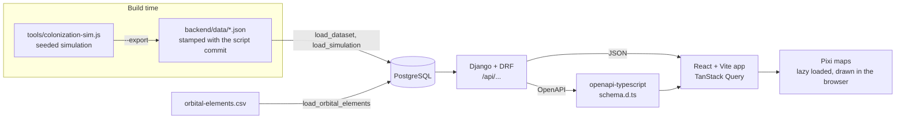

# Planet2Planet

A telecom comparison-shopping site set in the Sol system in 2380, in the Star Trek universe.
Pick two worlds and compare the interplanetary subspace plans that connect them on price,
latency, route and resilience.

See [PLAN.md](PLAN.md) for the full build plan.

## Fan work disclaimer

Planet2Planet is unofficial fan work. It is not affiliated with, endorsed by or sponsored by
Paramount, CBS Studios or any Star Trek rights holder. It uses no Star Trek logos, insignia,
images or interface designs. Canon facts come from on-screen sources; pricing, company names
and the solar conjunction rule are invented for this project.

## Quick start

```sh
cp .env.example .env
make up
```

Then load the data and start the frontend:

```sh
make seed                 # migrate, then load the dataset, network and plans
cd frontend && npm install && npm run dev
```

Open the URL Vite prints (usually http://127.0.0.1:5173). The API runs on
http://127.0.0.1:8000, with Swagger docs at `/api/docs/` and the admin at `/admin/`
(`docker compose run --rm backend python manage.py createsuperuser` first).

To regenerate the dataset and the Monte Carlo summary (commit the script first, because the files record its commit):

```sh
node tools/colonization-sim.js 1701 400 --export
make seed
```

Set `VITE_REPO_URL` in `frontend/.env` (see `frontend/.env.example`) so the Canon page can link to the script at that commit.

Requires Docker with Compose, and `make`. Node LTS and Python 3.12+ are only needed to run
tools outside containers.

## Architecture



- The backend owns the data, the network graph, routing and pricing. Plans and prices are computed per request and are the only thing the site charges for; nothing is ordered.
- Map positions are aesthetic and live in the client. The backend sends Kepler elements, and the browser animates them (log radial scaling is display-only).
- The API schema is generated (`backend/openapi.yaml`) and the frontend types come from it, so a change on either side that is not reflected on the other fails CI.
- Decisions are recorded in [docs/adr](docs/adr).

## Make targets

| Target | What it does |
| --- | --- |
| `make up` / `make down` | Start or stop the database and API in Docker |
| `make seed` | Migrate, then load the dataset, orbital elements, network, plans, canon facts and simulation |
| `make test` | Backend, tool and frontend unit tests |
| `make lint` | Ruff, ESLint, Prettier and the type check |
| `make schema` | Regenerate `openapi.yaml` and the frontend types |
| `make size` | Build, then check the first-page bundle budgets and that the map renderer stays lazy |
| `make e2e` | Browser tests in Chromium and WebKit (needs `make up && make seed`) |
| `make e2e-update` | Refresh this machine's pixel baselines |

## Testing

- **Backend:** pytest-django, run in Docker. Includes data-integrity checks (`check_data`) that CI also runs against the seeded database.
- **Frontend:** Vitest and Testing Library for logic and components, including the camera and scaling maths.
- **Tools:** `node --test tools/*.test.js` for the simulation, which is deterministic by seed.
- **End to end:** Playwright against the Vite dev server and the real API, on a phone, a tablet, a desktop and an iPhone-sized WebKit. Axe checks WCAG 2.2 AA on every page in both themes. Pixel snapshots are tagged `@visual`, are per platform, and are skipped in CI. See [ADR 0005](docs/adr/0005-testing-strategy.md).

## Layout

- `backend/`: Django + DRF API and PostgreSQL data
- `frontend/`: React + Vite app, including the Pixi map code
- `e2e/`: Playwright browser tests
- `tools/`: the simulation script that regenerates the dataset
- `docs/`: derivation notes and architecture decision records

## Licence

[MIT](LICENSE). The fan disclaimer above applies to all content.
