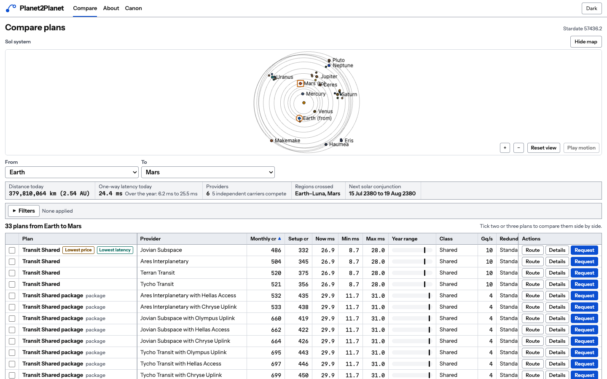
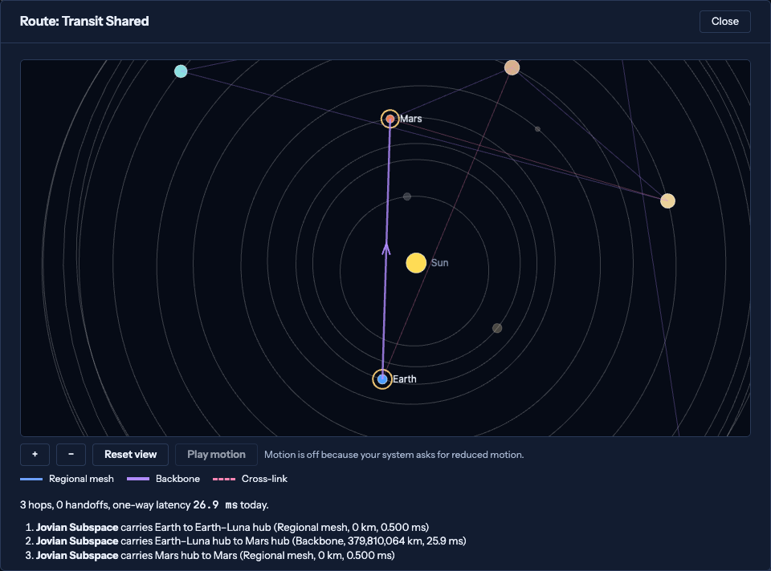
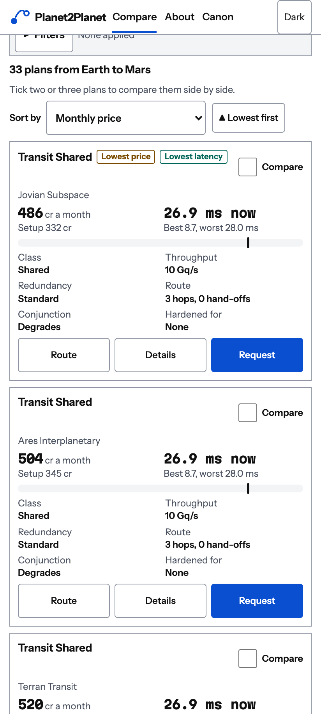
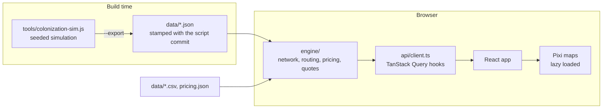

# Planet2Planet

A telecom comparison-shopping site set in the Sol system in 2380, in the Star Trek universe.
Pick two worlds and compare the interplanetary subspace plans that connect them on price,
latency, route and resilience.

Live at [planet2planet.com](https://planet2planet.com). A static site built with React, TypeScript and Vite. The pricing, routing and orbital maths run in the
browser from data files in this repository, so it can be hosted anywhere that serves files. See
[PLAN.md](PLAN.md) for the original build plan.

> **Looking for the full-stack version?** The `full-stack-aws` branch keeps the original architecture
> (Django REST Framework, PostgreSQL, Docker, AWS) as a frozen reference example. This branch dropped the
> backend once nothing needed a server; [ADR 0007](docs/adr/0007-static-hosting.md) explains how.

## Fan work disclaimer

Planet2Planet is unofficial fan work. It is not affiliated with, endorsed by or sponsored by
Paramount, CBS Studios or any Star Trek rights holder. It uses no Star Trek logos, insignia,
images or interface designs. Canon facts come from on-screen sources; pricing, company names
and the solar conjunction rule are invented for this project.

## What is on the site

- **Compare** (`/`): choose two worlds on an animated map of the system and see every plan that
  connects them. Plans are a sortable, spreadsheet-style table on wide screens and cards with a
  "Sort by" select on narrow ones. A filter drawer narrows by service class, sector, redundancy
  tier, provider and more. Each plan has a price breakdown, a route map, and up
  to three plans can be compared side by side. The whole view is kept in the URL, so it can be
  shared.
- **About** (`/about`): a timeline of the networks and companies, a network map with provider
  filters, how subspace communication works, and the redundancy tiers.
- **Canon** (`/canon`): every fact the setting rests on with its on-screen source, the
  Monte Carlo results of the colonization simulation, and a year-by-year history map.
- **Link preview**: `frontend/public/og.png`, shown when the site is shared, generated from the
  site with `make og`.

The site is light by default, with a dark theme, and is tested against WCAG 2.2 AA in both.

## Screenshots



<p align="center">
  
  
</p>

## Quick start

```sh
cd frontend
npm install
npm run dev
```

Open the URL Vite prints (usually http://127.0.0.1:5173). Needs Node LTS. There is no database, API or Docker.

Set `VITE_REPO_URL` in `frontend/.env` (see `frontend/.env.example`) so the Canon page can link to
the repository. Left empty, those links show as plain paths.

## Architecture



- `frontend/src/engine/` does what the backend used to: it builds the carrier network from the dataset, works out
  planetary positions, finds routes, prices plans and answers quotes with filters and sorting. It loads on demand,
  and the data files load separately, so the first page stays small.
- The app asks for the same paths the old API served (`/api/quotes/?from=jupiter&to=saturn`), and the engine
  answers them in the page. The components, hooks and response types did not change.
- The engine reproduces the Django backend's output exactly. The tests compare it with the old output
  for every pair of worlds. See [ADR 0007](docs/adr/0007-static-hosting.md).
- Map positions are aesthetic. The browser animates Kepler elements (log radial scaling is display-only).
- Decisions are recorded in [docs/adr](docs/adr).

## Data pipeline

The history of the setting comes from a deterministic, seeded simulation. Seed 1701 is the run the
site shows, and 400 further runs summarise how much it could have varied. To regenerate the
dataset and the Monte Carlo summary (commit the script first, because the files record its commit):

```sh
node tools/colonization-sim.js 1701 400 --export
cd frontend && npm test
```

The export writes to `data/`. Prices, plan templates and each company's price positioning are in
`data/pricing.json`, which is meant to be edited. See
[ADR 0004](docs/adr/0004-data-pipeline-and-canon-export.md).

## Make targets

| Target | What it does |
| --- | --- |
| `make dev` | Start the dev server |
| `make test` | Simulation tool tests, then the frontend tests (including the engine) |
| `make lint` | ESLint, Prettier and the type check |
| `make build` | Production build into `frontend/dist` |
| `make size` | Build, then check the first-page bundle budgets and that the map renderer stays lazy |
| `make e2e` | Browser tests in Chromium and WebKit |
| `make e2e-update` | Refresh this machine's pixel baselines |
| `make screenshots` | Regenerate the README screenshots in `docs/images` |
| `make og` | Regenerate the link-preview picture, `frontend/public/og.png` |

## Testing

- **Frontend:** Vitest and Testing Library for logic and components, including the camera and scaling maths.
- **Engine:** `frontend/src/engine/engine.spec.ts` checks the catalog, network, canon, twelve full quotes, a digest of every
  eighth pair and of 248 filtered queries against output captured from the Django backend. Set `GOLDEN_FULL_DIR` to a
  full dump to check all 1,056 pairs.
- **Tools:** `node --test tools/*.test.js` for the simulation, which is deterministic by seed.
- **End to end:** Playwright against the Vite dev server, on a phone, a tablet, a desktop and an iPhone-sized WebKit.
  Axe checks WCAG 2.2 AA on every page in both themes. Pixel snapshots are tagged `@visual`, are per platform, and
  are skipped in CI. See [ADR 0005](docs/adr/0005-testing-strategy.md).

CI (GitHub Actions) runs three jobs on every pull request and push to `main`: **frontend** (lint, formatting, unit
tests, the build and the bundle-size budget), **tools** (the simulation tests) and **e2e** (the browser tests,
without the `@visual` snapshots).

## Deploying

The site is deployed on [Vercel](https://vercel.com) at planet2planet.com. `vercel.json` at the repository root holds
everything Vercel needs, so import the repository and keep the defaults, with the root directory left at the repository
root (the build reads `data/`, which sits outside `frontend/`):

- the build runs `npm ci` and `npm run build` in `frontend/`, and publishes `frontend/dist`
- every path that is not a file is rewritten to `index.html`, because routes such as `/about` and `/canon` exist only in the browser
- files under `/assets` are cached for a year, as their names change with their content

Pushing to `main` deploys to production, and each pull request gets a preview URL. Any other static host works too, as long as
it serves `index.html` for unknown paths.

## Layout

- `frontend/`: the React + Vite app, including the engine (`src/engine`) and the Pixi map code
- `data/`: the inputs the site is built from (simulation exports, canon facts, orbital data, pricing)
- `e2e/`: Playwright browser tests and the link-preview and screenshot generators
- `tools/`: the simulation script that regenerates the dataset
- `docs/`: derivation notes, architecture decision records and the README screenshots
- `AGENTS.md`: orientation and rules for coding agents (`CLAUDE.md` points to it)

## Documentation

- [PLAN.md](PLAN.md): the full build plan
- [docs/sol-telecom-2380-derivation.md](docs/sol-telecom-2380-derivation.md): how the dataset is derived
- [ADR 0001](docs/adr/0001-existing-map-code.md): the map code
- [ADR 0002](docs/adr/0002-network-model.md): the network model
- [ADR 0003](docs/adr/0003-plans-and-pricing.md): plans, offers and pricing
- [ADR 0004](docs/adr/0004-data-pipeline-and-canon-export.md): the data pipeline and canon export
- [ADR 0005](docs/adr/0005-testing-strategy.md): the testing strategy
- [ADR 0006](docs/adr/0006-aws-deployment.md): the AWS deployment (superseded; the design survives on `full-stack-aws`)
- [ADR 0007](docs/adr/0007-static-hosting.md): static hosting, and the backend moved into the browser

## Licence

[MIT](LICENSE). The fan disclaimer above applies to all content.
