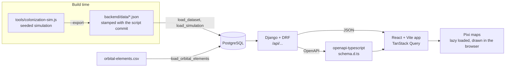

# Planet2Planet

A telecom comparison-shopping site set in the Sol system in 2380, in the Star Trek universe.
Pick two worlds and compare the interplanetary subspace plans that connect them on price,
latency, route and resilience.

Live at [planet2planet.com](https://planet2planet.com). Built with Django REST Framework,
PostgreSQL, React, TypeScript and Docker, and deployed to AWS. See [PLAN.md](PLAN.md) for the
full build plan.

## Fan work disclaimer

Planet2Planet is unofficial fan work. It is not affiliated with, endorsed by or sponsored by
Paramount, CBS Studios or any Star Trek rights holder. It uses no Star Trek logos, insignia,
images or interface designs. Canon facts come from on-screen sources; pricing, company names
and the solar conjunction rule are invented for this project.

## What is on the site

- **Compare** (`/`): choose two worlds on an animated map of the system and see every plan that
  connects them. Plans are a sortable, spreadsheet-style table on wide screens and cards with a
  "Sort by" select on narrow ones. A filter drawer narrows by service class, sector, redundancy
  tier, provider and more. Each plan has a price breakdown, a route map, a request form, and up
  to three plans can be compared side by side. The whole view is kept in the URL, so it can be
  shared.
- **About** (`/about`): a timeline of the networks and companies, a network map with provider
  filters, how subspace communication works, and the redundancy tiers.
- **Canon** (`/canon`): every fact the setting rests on with its on-screen source, the
  Monte Carlo results of the colonization simulation, and a year-by-year history map.
- **Link preview**: `frontend/public/og.png`, shown when the site is shared, generated from the
  live data with `make og`.

The site is light by default, with a dark theme, and is tested against WCAG 2.2 AA in both.

## Quick start

```sh
cp .env.example .env
make up
make seed                 # migrate, then load the dataset, orbital elements, network, plans, canon facts and simulation
cd frontend && npm install && npm run dev
```

Open the URL Vite prints (usually http://127.0.0.1:5173). The API runs on
http://127.0.0.1:8000, with Swagger docs at `/api/docs/` and the admin at `/admin/`
(`docker compose run --rm backend python manage.py createsuperuser` first). The dev server
proxies `/api` to the API; set `API_URL` to point it elsewhere.

Requires Docker with Compose, and `make`. Node LTS and Python 3.12+ are only needed to run
tools outside containers.

Set `VITE_REPO_URL` in `frontend/.env` (see `frontend/.env.example`) so the Canon page can link to
the repository. Left empty, those links show as plain paths.

## Architecture



- The backend owns the data, the network graph, routing and pricing. Plans and prices are computed per request. Nothing can be ordered: the request form stores an inquiry, rate limited to five a minute.
- Map positions are aesthetic and live in the client. The backend sends Kepler elements, and the browser animates them (log radial scaling is display-only).
- The API schema is generated (`backend/openapi.yaml`) and the frontend types come from it, so a change on either side that is not reflected on the other fails CI.
- In production, Caddy serves the built frontend and proxies `/api`, `/admin` and `/static` to Django under gunicorn, so the site and API share one origin.
- Decisions are recorded in [docs/adr](docs/adr).

## API

Interactive docs are at `/api/docs/`, and the schema at `/api/schema/`. Responses are camelCase JSON.

| Endpoint | What it returns |
| --- | --- |
| `GET /api/meta/`, `/api/worlds/`, `/api/worlds/<id>/`, `/api/regions/`, `/api/companies/` | The setting: worlds, regions and the telecom companies |
| `GET /api/history/` | Timeline events |
| `GET /api/network/` | The network graph and the orbit data the maps use |
| `GET /api/quotes/?from=&to=` | Every offer between two worlds, with filters and a price breakdown |
| `POST /api/inquiries/` | Stores a plan inquiry (rate limited) |
| `GET /api/canon/facts/`, `/api/simulation/`, `/api/simulation/worlds/` | Canon facts and the Monte Carlo results |
| `GET /api/health/` | A liveness check |

## Data pipeline

The history of the setting comes from a deterministic, seeded simulation. Seed 1701 is the run the
site shows, and 400 further runs summarise how much it could have varied. To regenerate the
dataset and the Monte Carlo summary (commit the script first, because the files record its commit):

```sh
node tools/colonization-sim.js 1701 400 --export
make seed
```

`load_simulation` rejects data files recorded against different script commits, and
`load_canon_facts` rejects any fact that has no source. `python manage.py check_data` prices every pair of worlds and reports any problem. See
[ADR 0004](docs/adr/0004-data-pipeline-and-canon-export.md).

## Make targets

| Target | What it does |
| --- | --- |
| `make up` / `make down` | Start or stop the database and API in Docker |
| `make seed` | Migrate, then load the dataset, orbital elements, network, plans, canon facts and simulation |
| `make test` | Backend, tool and frontend unit tests |
| `make test-backend` | Backend tests only |
| `make lint` | Ruff, ESLint, Prettier and the type check |
| `make lint-backend` | Ruff only, in Docker |
| `make schema` | Regenerate `openapi.yaml` and the frontend types |
| `make size` | Build, then check the first-page bundle budgets and that the map renderer stays lazy |
| `make e2e` | Browser tests in Chromium and WebKit (needs `make up && make seed`) |
| `make e2e-update` | Refresh this machine's pixel baselines |
| `make og` | Regenerate the link-preview picture, `frontend/public/og.png` (needs `make up && make seed`) |
| `make deploy` | Create or update the AWS deployment |
| `make deploy-status` / `make deploy-ssh` | Show the deployment's state, or open a shell on the server |
| `make destroy` | Delete everything `make deploy` created (asks first) |

## Testing

- **Backend:** pytest-django, run in Docker. Includes data-integrity checks (`check_data`) that CI also runs against the seeded database.
- **Frontend:** Vitest and Testing Library for logic and components, including the camera and scaling maths.
- **Tools:** `node --test tools/*.test.js` for the simulation, which is deterministic by seed.
- **End to end:** Playwright against the Vite dev server and the real API, on a phone, a tablet, a desktop and an iPhone-sized WebKit. Axe checks WCAG 2.2 AA on every page in both themes. Pixel snapshots are tagged `@visual`, are per platform, and are skipped in CI. See [ADR 0005](docs/adr/0005-testing-strategy.md).

CI (GitHub Actions) runs four jobs on every pull request and push to `main`:

- **frontend:** the API types are up to date, lint, formatting, unit tests, the build, and the bundle-size budget.
- **tools:** the simulation tests.
- **backend:** Ruff, pytest, seeding and `check_data`, and a check that `openapi.yaml` is up to date.
- **e2e:** the browser tests against a seeded stack, without the `@visual` snapshots.

## Deploying to AWS

One command puts the site on a single Lightsail instance (about $7 a month) with HTTPS:

```sh
make deploy          # uses the AWS profile "planet2planet", region us-east-1, domain planet2planet.com
make deploy-status   # instance, DNS and HTTPS
make destroy         # delete everything it created (asks first)
```

It needs the AWS CLI, `ssh`, `rsync`, `npm` and `dig` on your machine. The script builds the
frontend locally, uploads it with the backend, and runs Caddy, gunicorn and PostgreSQL in Docker
Compose (`docker-compose.prod.yml`). It generates the database password and `SECRET_KEY` into the
git-ignored `.deploy/` folder, loads the data on the first deploy, and installs a nightly database
backup kept for 14 days. On the first run it prints the two DNS records to add at your registrar;
Caddy then requests the HTTPS certificate on its own.

It is safe to run again. Settings are environment variables:

| Variable | Default | Effect |
| --- | --- | --- |
| `AWS_PROFILE` | `planet2planet` | The AWS CLI profile to use |
| `AWS_REGION` | `us-east-1` | The region |
| `DOMAIN` | `planet2planet.com` | The site's domain |
| `BUNDLE` | `micro_3_0` | The Lightsail instance size (1 GB RAM) |
| `SEED=1` | off | Reload the data on this deploy |
| `SNAPSHOTS=1` | off | Turn on daily Lightsail snapshots (extra cost) |
| `BUDGET_EMAIL` | none | Create a $10 a month AWS Budgets alert that emails this address |

See [ADR 0006](docs/adr/0006-aws-deployment.md) for the design and what it costs.

## Layout

- `backend/`: Django + DRF API and PostgreSQL data
- `frontend/`: React + Vite app, including the Pixi map code
- `e2e/`: Playwright browser tests and the link-preview generator
- `tools/`: the simulation script that regenerates the dataset
- `deploy/`: the AWS deployment script
- `docker-compose.yml`: the local database and API; `docker-compose.prod.yml` and `Caddyfile`: the production stack
- `docs/`: derivation notes and architecture decision records

## Documentation

- [PLAN.md](PLAN.md): the full build plan
- [docs/sol-telecom-2380-derivation.md](docs/sol-telecom-2380-derivation.md): how the dataset is derived
- [ADR 0001](docs/adr/0001-existing-map-code.md): the map code
- [ADR 0002](docs/adr/0002-network-model.md): the network model
- [ADR 0003](docs/adr/0003-plans-and-pricing.md): plans, offers and pricing
- [ADR 0004](docs/adr/0004-data-pipeline-and-canon-export.md): the data pipeline and canon export
- [ADR 0005](docs/adr/0005-testing-strategy.md): the testing strategy
- [ADR 0006](docs/adr/0006-aws-deployment.md): the AWS deployment

## Licence

[MIT](LICENSE). The fan disclaimer above applies to all content.
